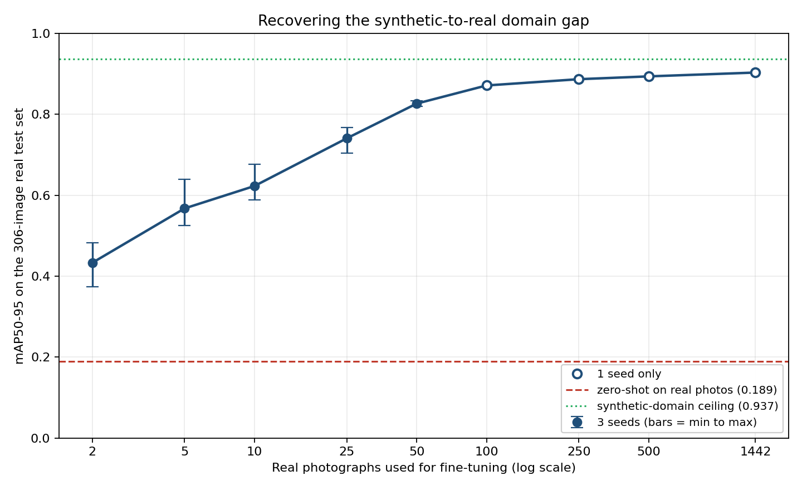

 # Progress and Results Log

Real-time chess piece detection with YOLOv8: a domain gap analysis.
AIML339, Anjola Sigbeku (300665808), Victoria University of Wellington.

Running record of experiments, findings, and decisions. Source material for
the evaluation and final reports.

---

## Status

| Stage | State |
|---|---|
| Dataset acquisition and conversion | Done |
| Data audit | Done, zero errors |
| YOLOv8 training on synthetic data | Done, 8 epochs |
| Stratified evaluation on synthetic test set | Done |
| Real benchmark acquired (ChessReD2K) | Done, 2,078 images |
| **Domain gap measured** | **Done: 0.9366 -> 0.1895** |
| **Data efficiency curve** | **Done: 2 images double it, elbow at 25-50** |
| **Multi-seed variance (N<=50)** | **Done: 3 seeds, spread collapses by N=50** |
| Own photograph capture | Not started |
| ResNet-50 baseline | Not started |
| Live webcam demo | Not started |

## Headline result

A YOLOv8s detector trained only on Blender renders scores **mAP50-95 = 0.9366**
on rendered test images and **0.1895** on 306 real smartphone photographs.

That is an absolute drop of 0.7471, or **79.8% of performance lost**, with no
change to the model or the task. The domain gap is not a marginal effect.

---

## Dataset

Rendered chess positions from Wölflein and Arandjelović, released openly at
[OSF](https://doi.org/10.17605/OSF.IO/XF3KA) under the chesscog project.
Chosen over the Roboflow alternatives, which held 46 to roughly 1,000 images
and in several cases did not distinguish piece colour at all. A label reading
only `bishop` cannot yield a FEN string.

| | Images | Boxes |
|---|---|---|
| train | 4,400 | 94,299 |
| val | 146 | 3,207 |
| test | 342 | 7,387 |
| **total** | **4,888** | **104,893** |

Twelve classes: six piece types across two colours, taken from FEN symbols
(uppercase white, lowercase black). Mean 21.5 boxes per image.

### Annotation quality

Every image ships a JSON containing the FEN, board corner coordinates, camera
angle, lighting mode, and exact per-piece bounding boxes computed in Blender by
projecting each piece's mesh vertices through the camera. Boxes are therefore
geometrically exact rather than hand-drawn.

Conversion to YOLO format produced **zero errors**: no malformed labels, no
out-of-range coordinates, no degenerate boxes, no unrecognised piece symbols.

### Validation check worth recording

`white-king` and `black-king` each total exactly **4,888** instances, matching
the image count precisely. Every legal chess position contains exactly one king
per side, so this independently confirms that FEN parsing, box extraction, and
image-to-annotation pairing are all correct. Any partial processing or symbol
misparse would break this identity.

The `min 2 / max 32` boxes-per-image bounds confirm it from the other side: 2 is
a bare-kings endgame, 32 a starting position. Both are exactly the legal limits.

### Class balance

Pawn-to-queen ratio is 8.6:1. This is intrinsic to chess, not a defect: eight
pawns per side against at most one queen. Kings appear in 100% of positions and
queens in about 64%, the signature of positions drawn from real games rather
than sampled uniformly.

**Decision: do not rebalance.** Report per-class AP so rare-class performance
stays visible instead of being absorbed into an aggregate dominated by pawns.

---

## Experiment 1: YOLOv8s on synthetic data

### Setup

| Parameter | Value |
|---|---|
| Model | yolov8s (11,140,228 parameters) |
| Epochs completed | 8 (of 50 requested) |
| Batch size | 16 |
| Image size | 640 |
| Seed | 42 |
| Hardware | Colab T4, 3.94 GB GPU memory used |
| Augmentation | HSV jitter, ±15° rotation, translate 0.1, scale 0.5, horizontal flip, mosaic |

Training was cut short when Colab reclaimed the session. Per-epoch checkpointing
meant `best.pt` survived on Drive. Results below come from that 8-epoch model.

Validation metrics had largely plateaued by then: mAP50-95 moved 0.907 → 0.910
→ 0.929 across epochs 3 to 5, climbing slowly from an already high base. The
synthetic task saturates quickly, which is itself relevant to the project's
argument.

### Results by render condition (test split, 342 images)

| Stratum | Images | mAP50-95 | mAP50 | Precision | Recall |
|---|---|---|---|---|---|
| **overall** | 342 | **0.9366** | 0.995 | 0.9975 | 0.9963 |
| angle 45–49° | 120 | 0.9302 | 0.995 | 0.9960 | 0.9944 |
| angle 50–54° | 118 | 0.9401 | 0.995 | 0.9967 | 0.9981 |
| angle 55–60° | 104 | 0.9425 | 0.995 | 0.9972 | 0.9983 |
| flash | 176 | 0.9413 | 0.995 | 0.9987 | 0.9989 |
| spotlights | 166 | 0.9329 | 0.995 | 0.9933 | 0.9964 |

### Per-class mAP50-95

| Class | mAP50-95 | | Class | mAP50-95 |
|---|---|---|---|---|
| black-knight | 0.9141 | | black-rook | 0.9399 |
| white-knight | 0.9188 | | black-queen | 0.9400 |
| black-pawn | 0.9257 | | white-king | 0.9429 |
| black-king | 0.9307 | | white-queen | 0.9473 |
| white-pawn | 0.9332 | | white-bishop | 0.9511 |
| black-bishop | 0.9366 | | white-rook | 0.9595 |

---

## Findings

### F1. Shallow camera angles are harder, monotonically

0.9302 → 0.9401 → 0.9425 as the camera rises from 45° to 60° above the board.

The renderer measures angle from horizontal, so 45° is side-on and 60° is closer
to overhead. Side-on views stack pieces in front of one another, so this is an
occlusion effect: the flatter the view, the more back-rank pieces are hidden
behind front-rank ones.

A monotonic trend across three independent bins is stronger evidence than any
single pairwise comparison would be.

### F2. Knights are the hardest class, and the reason is geometric

The two knights are the two worst classes (0.9141, 0.9188) against 0.9257 for
the next worst, a clear margin.

Every other piece is a surface of revolution: a pawn, rook, bishop, queen or
king looks the same from any direction. The renderer randomises each piece's
Z-rotation across a full 360°, so only the knight changes appearance as it
turns.

This matters for augmentation strategy. Rotation augmentation cannot fix a class
whose underlying object genuinely is not rotation-invariant; it can only expose
the model to more of that variation. The knight is the one class where extra
training data would plausibly help more than extra augmentation.

### F3. White pieces outperform black for every piece type

| Piece | White | Black | Difference |
|---|---|---|---|
| rook | 0.9595 | 0.9399 | +0.0196 |
| bishop | 0.9511 | 0.9366 | +0.0146 |
| king | 0.9429 | 0.9307 | +0.0122 |
| pawn | 0.9332 | 0.9257 | +0.0075 |
| queen | 0.9473 | 0.9400 | +0.0073 |
| knight | 0.9188 | 0.9141 | +0.0047 |

Six out of six in the same direction. Under a null of no effect, a two-tailed
sign test gives p ≈ 0.031. Mean advantage 0.011.

Dark pieces absorb light and expose less surface detail, so their edges localise
less precisely. That penalises mAP50-95, which is strict about box overlap,
while leaving mAP50 untouched.

Caveat: the six comparisons share the same images and so are not fully
independent, which weakens the nominal p-value.

### F4. mAP50 has no discriminative power on this task

It reads 0.995 in **every** stratum. Identical across camera angles, lighting
conditions, and overall.

All the signal lives in mAP50-95. Reporting mAP50 alone would have concealed
every finding above. Worth stating explicitly in the report as a methodological
point rather than leaving it implicit.

---

---

## Experiment 2: synthetic-trained model on real photographs

The 8-epoch model from Experiment 1, unchanged, evaluated on the ChessReD2K
test split: 306 real smartphone photographs, 6,294 boxes, three handsets.

| Metric | Synthetic | Real | Change |
|---|---|---|---|
| mAP50-95 | 0.9366 | **0.1895** | −79.8% |
| mAP50 | 0.995 | 0.2687 | −73.0% |
| Precision | 0.9975 | 0.2441 | −75.5% |
| Recall | 0.9963 | 0.4036 | −59.5% |

### F5. Rooks survive the domain shift; nothing else does

Retention of synthetic performance, per class:

| Class | Synthetic | Real | Retained |
|---|---|---|---|
| white-rook | 0.960 | 0.602 | **62.7%** |
| black-rook | 0.940 | 0.557 | **59.3%** |
| white-king | 0.943 | 0.329 | 34.9% |
| black-king | 0.931 | 0.153 | 16.4% |
| white-queen | 0.947 | 0.134 | 14.1% |
| white-pawn | 0.933 | 0.123 | 13.2% |
| black-pawn | 0.926 | 0.099 | 10.7% |
| white-bishop | 0.951 | 0.088 | 9.3% |
| black-knight | 0.914 | 0.066 | 7.2% |
| white-knight | 0.919 | 0.045 | 5.0% |
| black-queen | 0.940 | 0.042 | 4.5% |
| black-bishop | 0.937 | 0.034 | **3.7%** |

Rooks average 0.579 against 0.112 for everything else: **5.2x better**.

The explanation is geometric. A rook is close to a plain cylinder with a
crenellated top, and that silhouette is nearly identical whether modelled in
Blender or moulded in plastic. Bishops, queens and knights are where chess set
designs actually differ from one another, so the rendered form the model learned
does not match the physical pieces it now sees.

This reframes the domain gap. It is not a uniform degradation but a
**shape-fidelity effect**: classes whose geometry is stable across chess sets
transfer, and classes whose geometry is stylistic do not.

### F6. The white advantage widens 5.6x on real images

Mean white-over-black advantage rises from **+0.0110** on renders to **+0.0617**
on photographs. Queens (+0.091) and kings (+0.177) show the largest gaps.

Consistent with the F3 explanation but much stronger: real dark plastic under
ordinary room lighting reveals far less surface detail than a Blender material
under controlled lights. Knights are now the one exception where black scores
higher, though both are near the floor and the difference is small.

### F7. Localisation survives better than classification

On real photographs recall (0.4036) exceeds precision (0.2441) by 0.16, having
been balanced on renders (0.9963 vs 0.9975).

The model still finds objects that look like chess pieces but assigns the wrong
class to them. This is diagnostically useful: it points at the piece classifier
rather than the detector as the thing the domain shift breaks, and suggests
fine-tuning may recover a large share of the loss.

### F8. The camera strata are confounded and must not be reported

Apparent differences by handset (Huawei 0.2401, Samsung 0.1912, iPhone 0.1571)
**cannot be attributed to the sensor.** The ChessReD2K test split contains three
games, and each was photographed with exactly one camera:

| Camera | Images | Game |
|---|---|---|
| Huawei P40 pro | 103 | 0 |
| Apple iPhone 12 | 103 | 33 |
| Samsung Galaxy S8 | 100 | 76 |

Camera and game are therefore the same variable. Any difference could equally be
the board, the piece set, the room, the lighting or the table. Reporting this as
a sensor effect would be an error.

This limits stratification on real data to nothing useful, which is a concrete
argument for capturing my own photographs where angle and lighting can be varied
deliberately while holding the set constant.

---

## Experiment 3: data efficiency of fine-tuning

Starting from the synthetic-trained model, fine-tuned on N real photographs
drawn from the ChessReD2K training split, evaluated each time on the same
306-image test split. Sampling is stratified across games so small N draws
distinct boards rather than consecutive moves of one position. Training
validates on the val split; the test split is never seen during training.

All points up to N=50 are means over **three seeds** (42, 43, 44). Each seed
changes both which images are drawn and the training initialisation, so the
spread covers both sources of variance. Points from N=100 up are single runs.

| N | mAP50-95 | sd | mAP50 | Precision | Recall | % of full-data | Gap closed | seeds |
|---|---|---|---|---|---|---|---|---|
| 0 | 0.1895 | -- | 0.2687 | 0.244 | 0.404 | 21.0% | 0% | 1 |
| 2 | 0.4330 | 0.0549 | 0.5987 | 0.532 | 0.644 | 48.0% | 32.6% | 3 |
| 5 | 0.5673 | 0.0630 | 0.7466 | 0.661 | 0.764 | 62.8% | 50.6% | 3 |
| 10 | 0.6227 | 0.0476 | 0.7965 | 0.707 | 0.801 | 69.0% | 58.0% | 3 |
| 25 | 0.7405 | 0.0324 | 0.8765 | 0.781 | 0.854 | 82.0% | 73.8% | 3 |
| 50 | 0.8262 | 0.0069 | 0.9580 | 0.892 | 0.900 | 91.5% | 85.2% | 3 |
| 100 | 0.8711 | -- | 0.9896 | 0.971 | 0.967 | 96.5% | 91.2% | 1 |
| 250 | 0.8865 | -- | 0.9939 | 0.987 | 0.981 | 98.2% | 93.3% | 1 |
| 500 | 0.8935 | -- | 0.9940 | 0.989 | 0.985 | 99.0% | 94.2% | 1 |
| 1442 | 0.9029 | -- | 0.9949 | 0.996 | 0.994 | 100% | 95.5% | 1 |

"Gap closed" is measured against the 0.7471 that the domain shift cost.

### F9. Two photographs double performance; the curve bends at 25 to 50

Two real images take mAP50-95 from 0.1895 to **0.4330 ± 0.0549**, a 2.3×
improvement from two examples. The claim survives the seed spread: the worst of
three draws still reached 0.3737, a 1.97× gain, and the best reached 0.4823.
This replicates Wölflein and Arandjelović, who used exactly two photographs to
fine-tune their three-stage pipeline, and shows the effect is not specific to
their architecture: it holds for an end-to-end detector too.

The elbow sits between 25 and 100 images:

- 25 images reach **82%** of full-data performance
- 50 reach **91.5%**
- 100 reach **96.5%**
- the remaining 1,342 images add only **0.032**

Marginal value per image collapses by four orders of magnitude across the
curve, from 122 mAP points per 1,000 images at the start to 0.01 at the end.

**Practical claim:** photographing your own chess set 25 to 50 times recovers
most of what a 1,442-image dataset would. Collecting hundreds is close to
wasted effort. For a system meant to be adapted to a user's own set, this is the
result that matters.

### F10. Fine-tuning fixes classification, exactly as F7 predicted

F7 observed that on real photographs recall exceeded precision by 0.16, meaning
the model located pieces but misclassified them. Fine-tuning closes that gap:

| N | Recall − Precision |
|---|---|
| 0 | +0.159 |
| 2 | +0.112 |
| 25 | +0.073 |
| 50 | +0.008 |
| 100 | −0.004 |
| 1442 | −0.002 |

By N=100 the asymmetry is gone. The domain shift damaged the classifier far more
than the detector, and a modest number of real examples repairs it.

### F11. The fine-tuned model matches the synthetic ceiling on mAP50

| | mAP50-95 | mAP50 |
|---|---|---|
| Synthetic model, synthetic test | 0.9366 | 0.9950 |
| Fine-tuned model, **real** test | 0.9029 | 0.9949 |

At IoU 0.5 the real-domain model is indistinguishable from the synthetic model
operating in its own domain. The residual 0.034 gap in mAP50-95 is entirely
about strict box localisation, not detection or classification. Real photographs
have genuinely less certain object boundaries than renders, where the ground
truth came from exact mesh geometry.

### F12. Which images you pick matters as much as how many, until about N=50

The sweep was repeated across seeds 42, 43 and 44. Each seed redraws the sample
*and* reseeds training, so the spread below is the combined effect of both.

| N | mean | sd | min | max | spread |
|---|---|---|---|---|---|
| 2 | 0.4330 | 0.0549 | 0.3737 | 0.4823 | **0.1085** |
| 5 | 0.5673 | 0.0630 | 0.5248 | 0.6397 | **0.1149** |
| 10 | 0.6227 | 0.0476 | 0.5879 | 0.6769 | 0.0890 |
| 25 | 0.7405 | 0.0324 | 0.7046 | 0.7675 | 0.0629 |
| 50 | 0.8262 | 0.0069 | 0.8197 | 0.8334 | **0.0137** |

Spread falls by a factor of eight between N=5 and N=50, and standard deviation
by a factor of nine. At N=2 the spread is 0.109, which is 45% of the entire
gain those two images produce: the result is dominated by *which* two boards
happen to be drawn. By N=50 the spread is 0.014, smaller than the gap between
adjacent points on the curve.

This is a more useful statement than the raw curve on its own. It says the
practical recommendation is not merely "25 to 50 photographs is enough" but
"below about 25 photographs your result depends heavily on luck in what you
happened to photograph; above it you get a dependable outcome." For someone
adapting this system to their own chess set, the reliability threshold matters
as much as the performance threshold.

It also bounds what can be read off the curve. Differences smaller than the
local spread are not meaningful, and that threshold is **N-dependent**: roughly
0.11 at N=2–5, 0.06 at N=25, 0.014 at N=50. The earlier estimate of a flat
±0.05 everywhere was too optimistic at small N and too conservative at large N.

Two sources feed this. The sampling draw is the larger one and is intrinsic to
the question. The smaller one is hardware: Apple's MPS backend lacks
deterministic implementations of `scatter_reduce` and `index_put_with_accumulate`,
so `deterministic=True` degrades to warn-only and even a fixed seed is not
bit-reproducible. The two cannot be separated without re-running a fixed sample
under several training seeds, which is a cheap follow-up if it is worth doing.

Single-seed points remain at N=100 and above. They are drawn hollow on the
curve. Since spread is already 0.014 at N=50 and still falling, the variance
there is likely negligible, but it has not been measured.

---

## Caveats

Strata contain 104 to 176 images and the differences are around 0.01. Taken
individually these are not clearly significant.

- **F1** holds up because the trend is monotonic across three bins.
- **F3** holds up because the direction is consistent across six pairs.
- **The lighting difference** (0.9413 flash vs 0.9329 spotlights) rests on a
  single comparison and should be reported as suggestive, not established.

The validation split is small at 146 images, roughly 90 queen instances, which
makes per-class model selection noisy. The paper's 90/3/7 split was kept anyway
to preserve comparability with Wölflein's published numbers.

Bounding boxes are **amodal**: computed from all mesh vertices including those
occluded by other pieces. A partly hidden piece receives a box covering its full
extent rather than only its visible part. Defensible for chess, but a real
difference from hand-annotated datasets and worth disclosing.

---

## Corrections needed to the design report

| Claim in design report | Actual |
|---|---|
| ~3,000 training images | 4,888 images, 104,893 instances |
| 13 classes | 12 (the text already described 12) |
| Roboflow + Kaggle as data sources | chesscog rendered dataset |
| yolov8m, 50 epochs | yolov8s, 8 epochs completed |

---

## Next steps

Items 1 to 3 of the original list (capture real photographs, measure the gap,
fine-tune and re-measure) are done, using ChessReD2K rather than self-captured
images. What remains:

1. **Capture my own chessboard photographs.** No longer needed to measure the
   gap, but still the only way to test the angle and lighting findings (F1, F8)
   on real images with the chess set held constant, and the only way to show the
   practical claim on a set the model has never seen.
2. **ResNet-50 classification baseline** for comparison. Outstanding from the
   design report; worth confirming with the supervisor that it is still in scope
   given the project has turned into a detection study.
3. **Live webcam demo.**
4. **Evaluation report**, correcting the design report figures in the table
   above.
5. Optionally, separate sampling variance from MPS non-determinism by rerunning
   one fixed sample under several training seeds (F12). Cheap, and it would
   sharpen the claim.
6. Optionally resume training to 50 epochs. Low priority: expected gain is
   roughly +0.02 mAP50-95, and it is not where the contribution lies.

Have a look at Kaggle.
